<picture>
  <source media="(prefers-color-scheme: dark)" srcset="https://raw.githubusercontent.com/paulamori/paulamori/main/dist/pet.svg">
  <source media="(prefers-color-scheme: light)" srcset="https://raw.githubusercontent.com/paulamori/paulamori/main/dist/pet-light.svg">
  
</picture>

```python
  class paulamori:
    name= "Paula"
    college= "IFMG"
    course= "Computer Science"
    course_status= "ongoing"
    default_message: "Hiii! Welcome to my github! :)"
    description = "A curious and creative CS student passionate about Computer Vision, AI and learning new languages"

```
---
 ```python
print("Currently learning:")
```


---
 ```python
print("Find me here:")
```
<p align="left">
  <a href="https://www.linkedin.com/in/pauladeamorim"></a><a href="mailto:paulaadeamorim@gmail.com"></a>
</p>

---
 ```python
print("Hey, check my stats: ")
```
 

<picture>
  <source media="(prefers-color-scheme: dark)" srcset="https://raw.githubusercontent.com/paulamori/paulamori/main/dist/isocat.svg">
  <source media="(prefers-color-scheme: light)" srcset="https://raw.githubusercontent.com/paulamori/paulamori/main/dist/isocat-light.svg">
  
</picture>


